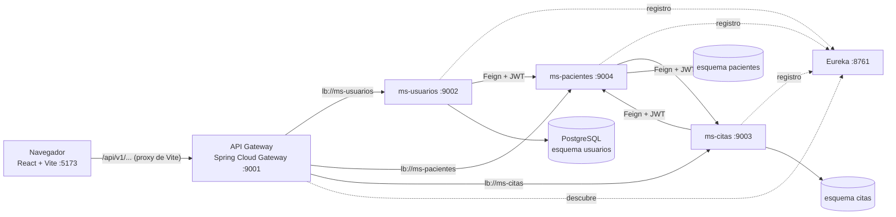
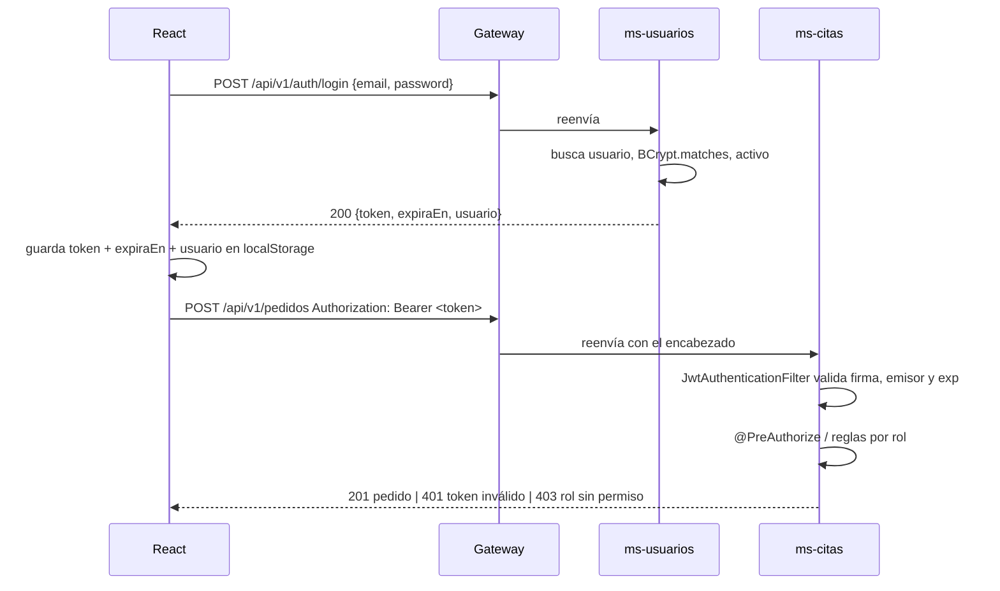

# Documento de integración frontend–backend

**Proyecto:** Veterinaria San Marcos · **Asignatura:** DSY1104 Desarrollo Fullstack II · **Evaluación:** EP3
**Integrantes:** Daniel More · Ignacio Álvarez · Luis

---

## 1. Arquitectura



| Componente | Tecnología | Responsabilidad |
| --- | --- | --- |
| Frontend | React 19, React Router 7, Vite | Vistas, validaciones de formulario, sesión y control de acceso de la interfaz |
| API Gateway | Spring Cloud Gateway (WebFlux) | Punto de entrada único; enruta por ruta a cada servicio vía Eureka; publica Swagger UI unificado |
| Eureka | Spring Cloud Netflix | Registro y descubrimiento de servicios |
| ms-usuarios | Spring Boot 3.5, JPA, Security | Login (emite JWT), registro, CRUD de usuarios, perfil |
| ms-pacientes | Spring Boot 3.5, JPA, Security | Mascotas, historial clínico y vacunas |
| ms-citas | Spring Boot 3.5, JPA, Security | Agenda de citas, catálogo (servicios y productos) y pedidos de la tienda |
| ms-commons | Librería Maven | Validación JWT, configuración de seguridad común, errores JSON y OpenAPI |
| PostgreSQL 16 | Un esquema por servicio | Persistencia; cada servicio tiene su propia cuenta de base de datos |

### Capas de cada microservicio

`controller` (REST + `@PreAuthorize`) → `service` (reglas de negocio, `@Transactional`) → `repository` (Spring Data JPA) → `entity` (JPA) → tabla PostgreSQL. Los `dto` (records de Java con Bean Validation) separan lo que entra y sale por la API de las entidades.

Ejemplo de recorrido completo (pedido de la tienda):
`CarritoPage.jsx` → `api/pedidos.js` → `POST /api/v1/pedidos` → Gateway → `PedidoController.crear` → `PedidoService.crear` → `ProductoRepository.bloquearPorCodigo` (SELECT … FOR UPDATE) → `PedidoRepository.save` → tablas `citas.pedidos` y `citas.pedido_detalle`.

## 2. Modelo de datos

| Esquema | Tabla | Entidad JPA | Notas |
| --- | --- | --- | --- |
| usuarios | `usuarios` | `Usuario` | RUN y correo únicos; `password` con BCrypt; `rol` ADMINISTRADOR, RECEPCIONISTA, VETERINARIO o DUENO |
| pacientes | `pacientes` | `Paciente` | `id_dueno` apunta a un usuario (sin FK entre esquemas) |
| pacientes | `atenciones_clinicas` | `AtencionClinica` | Historial; `@OneToMany` desde `Paciente` con borrado en cascada |
| pacientes | `historial_vacunas` | `Vacuna` | Ligada a la atención en que se aplicó (`id_atencion`) |
| citas | `catalogo_servicios` | `ServicioCatalogo` | 31 servicios precargados |
| citas | `citas` | `Cita` | Estado SOLICITADA, CONFIRMADA, REAGENDADA, COMPLETADA o CANCELADA; precio acordado al solicitar |
| citas | `productos` | `Producto` | 22 productos precargados, con stock |
| citas | `pedidos` / `pedido_detalle` | `Pedido` / `PedidoDetalle` | Guarda nombre y precio de cada ítem al momento de la compra |

## 3. Reglas de negocio implementadas en el backend

| Servicio | Regla | Dónde |
| --- | --- | --- |
| ms-usuarios | RUN chileno válido (módulo 11) y único | `ReglasUsuario.normalizarRun` |
| ms-usuarios | Dominio de correo según rol (admin `@duocuc.cl`, recepción `@gmail.com`, dueño `@profesor.duoc.cl`) | `ReglasUsuario.validarDominio` |
| ms-usuarios | Un administrador no puede cambiarse su rol, desactivarse ni eliminarse | `UsuarioService` |
| ms-usuarios | Solo se eliminan clientes sin mascotas (consulta a ms-pacientes) | `UsuarioService.eliminar` |
| ms-pacientes | Un dueño solo ve y modifica sus mascotas | `PacienteService.buscarVisible` |
| ms-pacientes | No se elimina una mascota con citas activas (consulta a ms-citas) | `PacienteService.eliminar` |
| ms-pacientes | Atención con fecha no futura; próximo control y vencimiento de vacuna posteriores | `PacienteService.registrarAtencion` |
| ms-citas | Horarios permitidos (09–12 y 15–17), fecha no pasada, un solo turno activo por horario | `CitaService.validarHorario` / `crear` |
| ms-citas | El servicio debe estar activo y admitir la especie de la mascota | `CitaService.crear` |
| ms-citas | El dueño solo agenda para sus mascotas (verificado en ms-pacientes) | `CitaService.crear` |
| ms-citas | Pedido: precio desde la base, stock suficiente, descuento atómico con bloqueo de fila | `PedidoService.crear` |
| ms-citas | Transiciones de pedido válidas y devolución de stock al cancelar | `PedidoService.cambiarEstado` |
| ms-citas | Servicio/producto en uso se desactiva en vez de borrarse | `CatalogoService.eliminar*` |

## 4. Autenticación y autorización (JWT)



- **Dónde se crea el token:** `JwtService.generar` (ms-commons), llamado por `AuthService.login` (ms-usuarios). Algoritmo HS256, expiración configurable (`JWT_EXPIRATION_MINUTES`).
- **Dónde se valida:** `JwtAuthenticationFilter` (ms-commons), registrado por `SeguridadComun.aplicar` en el `SecurityConfig` de cada microservicio. Si es válido, crea la autenticación con la autoridad `ROLE_<rol>`.
- **Cómo se verifica el rol:** `@EnableMethodSecurity` + `@PreAuthorize("hasRole('ADMINISTRADOR')")` en los controladores, y validaciones de propiedad en los servicios (`UsuarioActual.obtener()`).
- **Por qué el backend valida aunque el frontend oculte vistas:** cualquiera puede llamar a la API con Postman, curl o desde la consola del navegador. La interfaz es solo experiencia de usuario; la seguridad real está en el servidor.
- **Clave compartida:** todos los servicios reciben el mismo `JWT_SECRET` por variable de entorno, por eso cualquiera puede validar el token sin consultar a ms-usuarios.

### Matriz de permisos

| Acción | Dueño | Recepcionista | Administrador | Sin sesión |
| --- | --- | --- | --- | --- |
| Ver catálogo (`GET /servicios`, `GET /productos`) | ✓ | ✓ | ✓ | ✓ |
| Crear/editar/eliminar productos y servicios | 403 | 403 | ✓ | 401 |
| Confirmar un pedido (`POST /pedidos`) | ✓ | ✓ | ✓ | 401 |
| Ver todos los pedidos / cambiar su estado | 403 (solo cancelar el propio pendiente) | ✓ | ✓ | 401 |
| Listar mascotas | solo las propias | todas | todas | 401 |
| Registrar atención clínica | 403 | ✓ | ✓ | 401 |
| Solicitar cita | solo para mascotas propias | ✓ | ✓ | 401 |
| Confirmar / reprogramar cita | 403 (puede cancelar las propias) | ✓ | ✓ | 401 |
| CRUD de usuarios | 403 | solo lectura | ✓ | 401 |

## 5. Gestión de sesión en el frontend

| Situación | Qué ocurre | Código |
| --- | --- | --- |
| Inicio de sesión | Se guarda `{token, expiraEn, usuario}` en `localStorage['vet_sesion']`; nunca la contraseña | `api/sesion.js → guardarSesion` |
| Recarga del navegador | `App.jsx` lee la sesión (si no venció) y la confirma con `GET /auth/me` | `App.jsx`, efecto 1 |
| El token vence sin actividad | Un temporizador cierra la sesión en el instante de `exp` y redirige al login con mensaje | `App.jsx`, efecto 3 |
| El backend responde 401 | `api/cliente.js` borra la sesión y emite `vet:sesion-expirada`; la App vuelve al login | `cliente.js`, `App.jsx` efecto 2 |
| El backend responde 403 | Se muestra el mensaje del backend; la sesión se mantiene | `cliente.js` |
| Cuenta desactivada con token vigente | `GET /auth/me` responde 401 al recargar | `AuthService.sesionActual` |
| Cerrar sesión | Se elimina `vet_sesion` y se limpia el estado | `App.jsx → cerrarSesion` |

La versión anterior guardaba los usuarios con su contraseña en `localStorage`; al iniciar, `limpiarDatosLocalesAntiguos` borra esos datos.

## 6. Control de acceso en la interfaz

- `ProtectedRoute` redirige al login si no hay sesión y muestra «Acceso denegado» si el rol no corresponde.
- Rutas por rol: `/mascotas`, `/citas/nueva` (Dueño); `/recepcion/*` (Recepcionista y Administrador); `/admin/*` (Administrador).
- El menú se arma según el rol (`enlaces` en `App.jsx`), y las acciones (por ejemplo «Cancelar pedido») solo aparecen cuando el estado y el rol lo permiten.

## 7. Flujo REST desde React

1. Las vistas llaman funciones de `src/api/*` o de `src/data/veterinaria.js`, que conservan los nombres de la EP2 (`obtenerMascotas`, `registrarCita`…) pero ahora son asíncronas.
2. `api/cliente.js` arma la petición: URL relativa `/api/v1/...`, JSON y el encabezado `Authorization`.
3. En desarrollo, Vite reenvía `/api` al gateway (`vite.config.js`, variable `API_PROXY_TARGET`). Así el navegador no necesita CORS; el gateway igual tiene CORS para `localhost:5173`.
4. La respuesta se transforma al formato de la vista (`usuarioDesdeApi`, `mascotaDesdeApi`, `citaDesdeApi`, `pedidoDesdeApi`) y se actualiza el estado con `setState`.
5. Los errores llegan como `ApiError` con el mensaje del backend (`ErrorResponse.mensaje`) y se muestran en la vista.

Formato de error común (`GlobalExceptionHandler`):

```json
{
  "timestamp": "2026-11-25T14:03:11Z",
  "status": 409,
  "error": "Conflict",
  "mensaje": "Stock insuficiente para Pipeta felina. Disponible: 1.",
  "ruta": "/api/v1/pedidos"
}
```

## 8. Configuración

| Variable | Uso | Ejemplo (`.env.example`) |
| --- | --- | --- |
| `POSTGRES_PASSWORD` | Superusuario de PostgreSQL | `postgres_dev_123` |
| `DB_USUARIOS_PASSWORD`, `DB_PACIENTES_PASSWORD`, `DB_CITAS_PASSWORD` | Cuenta de cada servicio | `usuarios_dev_123` |
| `JWT_SECRET` | Clave HS256 compartida (mínimo 32 caracteres) | cadena aleatoria |
| `JWT_EXPIRATION_MINUTES` | Duración del token | `60` |
| `API_PROXY_TARGET` | Destino del proxy de Vite | `http://ms-api-gateway:9001` en Docker |
| `JPA_DDL_AUTO` | Modo de Hibernate | `none` (por defecto) o `validate` |

## 9. Pasos para ejecutar

1. Clonar el repositorio y copiar `.env.example` a `.env`.
2. `docker compose up --build -d` desde la raíz.
3. Esperar a que Eureka (http://localhost:8761) muestre los tres servicios.
4. Abrir http://localhost:5173 e ingresar con una cuenta de demostración (ver README).
5. Swagger: http://localhost:9001/swagger-ui.html → *Authorize* → pegar el token de `POST /api/v1/auth/login`.

Si ya existía un volumen de una versión anterior: `docker compose down --volumes` y volver al paso 2.

## 10. Pruebas de integración

Pruebas automatizadas incluidas:

- Backend: `*ApplicationTests` (cada servicio levanta con H2) y `ReglasUsuarioTest` (RUN y dominio).
- Frontend: `api/sesion.test.js` (persistencia, expiración, limpieza de datos antiguos) y `api/cliente.test.js` (token Bearer, 401, 403, 409, servidor caído).

Pruebas manuales de extremo a extremo (completar la columna «Resultado» al ejecutarlas antes de la entrega):

| # | Caso | Pasos | Resultado esperado | Resultado |
| --- | --- | --- | --- | --- |
| 1 | Login válido | Ingresar con `cliente@profesor.duoc.cl` | Entra a Inicio; `vet_sesion` contiene token y no contraseña | |
| 2 | Login inválido | Contraseña incorrecta | Mensaje «Credenciales inválidas o usuario desactivado» (401) | |
| 3 | Persistencia | Recargar con F5 | Sigue con sesión; en la pestaña Red aparece `GET /auth/me` 200 | |
| 4 | Expiración | `JWT_EXPIRATION_MINUTES=2`, esperar | Vuelve al login con «Tu sesión expiró…» | |
| 5 | Token alterado | Editar `vet_sesion.token` y recargar | `/auth/me` 401 y vuelve al login | |
| 6 | Ruta por rol | Como cliente abrir `/admin/usuarios` | «Acceso denegado» en la interfaz | |
| 7 | API por rol | Como cliente: `GET /api/v1/usuarios` en Swagger | 403 JSON | |
| 8 | Sin token | `GET /api/v1/pacientes` sin *Authorize* | 401 JSON | |
| 9 | CRUD producto | Admin: crear `ME023`, editar precio, eliminar | 201, 200, 204 y la tabla se actualiza | |
| 10 | Pedido | Cliente: agregar productos y confirmar | 201; el stock baja en el catálogo | |
| 11 | Stock insuficiente | Pedir más unidades que el stock (Swagger) | 409 con el stock disponible | |
| 12 | Cancelar pedido | Recepción cancela un pedido | Estado Cancelado y stock devuelto | |
| 13 | Cita | Cliente solicita cita para Luna | 201; aparece en Recepción como pendiente | |
| 14 | Horario ocupado | Otra cita en el mismo horario | 409 «Ese horario ya tiene una solicitud activa.» | |
| 15 | Mascota con citas | Eliminar Luna con cita activa | 409 «Cancela las citas activas…» | |
| 16 | Ficha clínica | Recepción registra atención con vacuna | Aparece en el historial y en avisos del dueño | |

## 11. Limitaciones y mejoras posibles

- El token no se puede revocar antes de su expiración (no hay lista negra ni refresh token); una cuenta desactivada conserva el acceso hasta que vence su token o hasta recargar (por `/auth/me`).
- El token se guarda en `localStorage`, accesible por JavaScript; una alternativa más resistente a XSS es una cookie `HttpOnly`.
- No hay pagos ni despacho: el pedido queda «Pendiente de confirmación».
- Las relaciones entre esquemas (dueño, mascota) se validan por API y no con claves foráneas, como corresponde a microservicios con datos separados.
