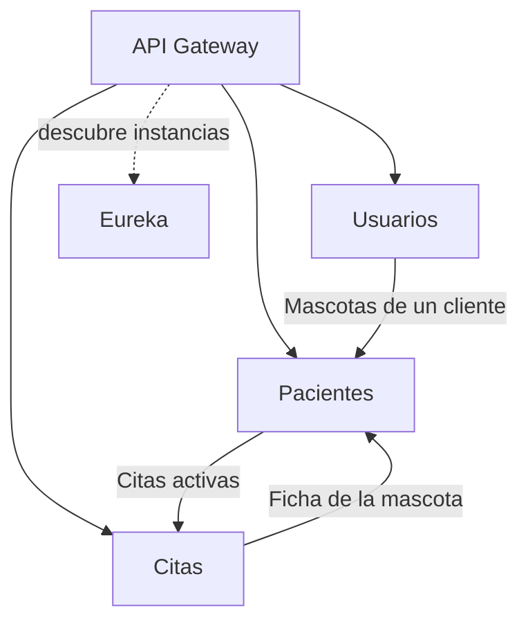

# Backend de Veterinaria San Marcos

Proyecto Maven multimódulo con Java 21, Spring Boot 3.5.14 y Spring Cloud. El cliente entra por el gateway. Eureka le indica dónde está cada servicio y el servicio de destino valida el JWT y los permisos del usuario.

| Módulo | Puerto del proceso | Responsabilidad |
| --- | --- | --- |
| `eureka` | 8761 | Registro de instancias de los tres servicios de negocio |
| `ms-api-gateway` | 9001 | Enrutamiento de la API y acceso común a Swagger |
| [Usuarios](ms-usuarios/README.md) | 9002 | Identidad, perfiles, roles y emisión de JWT |
| [Pacientes](ms-pacientes/README.md) | 9004 | Mascotas, atenciones e historial clínico |
| [Citas](ms-citas/README.md) | 9003 | Agenda, catálogos, inventario y pedidos |
| `ms-commons` | — | Biblioteca compartida para JWT, seguridad y manejo de errores |

## Levantar solo el backend

Desde la raíz del proyecto, prepara el archivo de entorno y construye los servicios. Compose también iniciará PostgreSQL y Eureka como dependencias.

```powershell
if (!(Test-Path .env)) { Copy-Item .env.example .env }
docker compose up -d --build ms-usuarios ms-pacientes ms-citas ms-api-gateway
docker compose ps
```

Abre [Eureka](http://localhost:8761) y espera a que aparezcan las tres instancias. Consulta el catálogo público con `Invoke-RestMethod http://localhost:9001/api/v1/productos`. En [Swagger UI](http://localhost:9001/swagger-ui.html) puedes seleccionar Usuarios, Pacientes o Citas. Compose publica el gateway, Eureka y PostgreSQL en el host. Los puertos 9002–9004 quedan dentro de la red de contenedores.

## Configuración y persistencia

| Variable | Uso |
| --- | --- |
| `DB_URL` | JDBC. Compose apunta a `postgres:5432/veterinaria` y la ejecución local a `localhost:5433/veterinaria` |
| `DB_USUARIOS_PASSWORD`, `DB_PACIENTES_PASSWORD`, `DB_CITAS_PASSWORD` | Cada servicio usa la contraseña de su propio rol en PostgreSQL |
| `EUREKA_URL` | Registro en `http://eureka:8761/eureka/` dentro de Compose o en `http://localhost:8761/eureka/` desde el host |
| `JWT_SECRET`, `JWT_EXPIRATION_MINUTES` | Clave compartida de al menos 32 caracteres y duración del token (60 minutos por defecto) |
| `JPA_DDL_AUTO` | Hibernate usa `none` por defecto. El valor `validate` permite contrastar tablas y entidades |

Los [scripts de inicialización](init-multi-db/README.md) crean tres esquemas en una sola base. Las consultas entre dominios usan OpenFeign y propagan la autorización de la petición. Usuarios consulta las mascotas antes de eliminar un cliente, Pacientes revisa la agenda antes de eliminar una mascota y Citas consulta su ficha al reservar.

## Arquitectura y comunicación



Las rutas del [gateway](ms-api-gateway/src/main/resources/application.yml) usan destinos `lb://`. Los clientes Feign también se dirigen al nombre registrado. Al investigar un fallo entre servicios conviene comprobar en Eureka tanto el servicio que recibió la operación como el que debe responder a su consulta.

| Capa del servicio | Qué buscar al seguir una petición |
| --- | --- |
| `controller` y `dto` | Ruta HTTP, campos de entrada y salida, validaciones y permisos por método |
| `service` y `client` | Reglas de negocio, transacciones y llamadas a otros servicios |
| `repository` y `entity` | Consultas JPA y correspondencia entre los objetos y las tablas |
| `ms-commons` | Filtro de autenticación y formato de error compartido |

## Compilación y diagnóstico

Con JDK 21 y Maven 3.9, ejecuta `mvn clean verify` desde esta carpeta para compilar el conjunto y ejecutar sus pruebas. Para empaquetar un solo servicio con sus dependencias usa, por ejemplo, `mvn -pl ms-citas -am package`. El [Dockerfile](Dockerfile) utiliza ese mismo reactor para construir el módulo indicado por `APP_MODULE` y ejecuta su JAR con un JRE 21.

| Síntoma | Comprobación |
| --- | --- |
| El catálogo responde con 503 al arrancar | Revisa el registro de Citas en Eureka y ejecuta `docker compose logs ms-api-gateway ms-citas` desde la raíz |
| La API privada devuelve 401 | Comprueba la expiración del token y que los tres módulos reciban el mismo `JWT_SECRET` |
| Una operación devuelve 403 | Revisa el rol y la propiedad del recurso. El campo `mensaje` explica el rechazo |
| Un servicio falla al abrir la conexión JDBC | Comprueba `DB_URL`, la contraseña de su rol y el estado de PostgreSQL. En Compose la dirección interna es `postgres:5432` |

## Desarrollo con Maven

Desde esta carpeta, ejecuta `mvn test` para probar el conjunto o `mvn -pl ms-pacientes -am test` para probar un módulo con sus dependencias. Para ejecutar los procesos desde el IDE o desde Maven, sigue la sección de ejecución local de la [guía del proyecto](../README.md).
